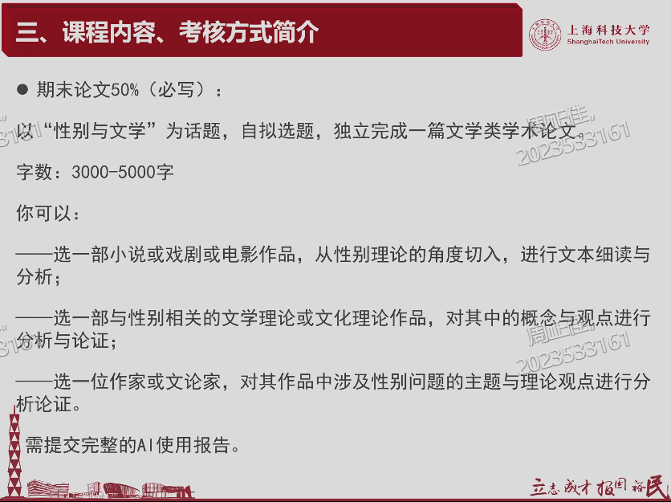
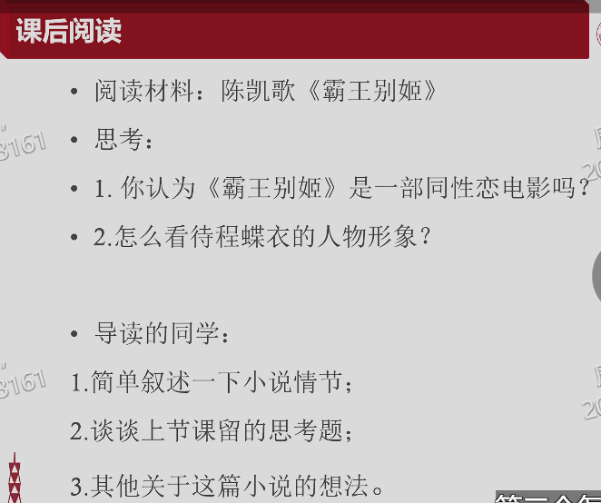

# 《霸王别姬》：AI 使用报告与完整对话记录

**姓名：________　学号：________**

关联正文：[11 月 8 日提交稿](11月8日提交稿_霸王别姬.md)。

本文件包含 AI 使用说明与完整对话记录；图片保存在同目录的 `Assets/` 文件夹中，通过相对路径引用。

## 一、AI 使用报告

### 1. 使用工具、时间与用途

本材料使用 OpenAI Codex 辅助完成。会话始于 2026 年 11 月 1 日，11 月 8 日继续。用途包括整理七次课堂记录中的提交要求、比较候选作品、联网检索和核对文献、形成文献摘要及比较问题、拟定提纲，以及起草本次提交材料。当前会话未提供可独立核实的具体模型版本，本报告不作猜测。

本稿正文由 AI 在既有调研基础上起草。AI 的检索、选读和写作不能代替提交者本人的阅读及判断；文中没有把 AI 处理资料的范围写成本人已经完成的阅读量。

### 2. 对输出的采纳、修改与保留意见

| 过程或建议 | 当前处理及理由 |
| --- | --- |
| 最初优先推荐《金锁记》。 | 未采用。本人随后明确选择更愿意研究的电影《霸王别姬》，相关讨论保留在完整记录中。 |
| 以课堂两道导读题直接作为论文题目。 | 只作为问题起点。需要将身份判断与人物评价进一步转化为可由场景论证的问题。 |
| 初轮英文材料较多。 | 要求重新调研并补入中文期刊，比较不同研究的证据与解释，不能用学者国籍代替发表语言。 |
| 以“谁必须从一而终”突出不对称。 | 本稿作了收束。保留这一疑问，但不在题目中提前认定全部结果；同时承认戴锦华等已有相关论述。 |
| 用性别理论解释男旦表演。 | 有条件采用。只借其提出问题，区分舞台角色、性别表现、性取向与性别认同，不由一种证据替代其他几种。 |
| 将摘要、目录或节选计为整篇、整书已读。 | 不采用。综述明确资料范围；林松辉等尚未取得完整相关章节的书，没有被列作本稿已经评述的专著。 |
| 对前人研究作“填补空白”式概括。 | 不采用。改为在已有解释基础上进行局部场景比较，不声称首次发现忠贞、菊仙或戏与人生的问题。 |

以上“本稿处理”包括本次由 AI 起草时作出的调整，不代表提交者已经独立确认每一处判断。提交者应在审阅后保留、修改或删除，并对最终材料负责。

### 3. 本人阅读及审阅记录

**此处由提交者据实补记，不由 AI 代填。**请写明实际亲自读过的篇目及页段，并至少说明一项自己赞同或修正的判断。若尚未完成，应如实写明当前进度；不得把关联正文“文献综述”中的 AI 选读范围直接复制为本人阅读证明。

本人实际阅读范围及审阅意见：____________________________________________________________

### 4. 对话附录说明

以下附录保留本次会话中与课程要求、作品选择、检索与写作相关的用户及 AI 可见对话，按出现顺序编排，包含最初《金锁记》的建议、之后的选题更改和中文文献补查，不只保留最终采纳的部分。原始图片保存在 Assets 文件夹，并在对应对话处通过相对路径引用；原文中的早期错误及其后续更正均保留。工具运行日志及自动环境信息不属于师生所要求的有来有往的研究对话，未列入附录。

附录记录的是对话本身；其中指向早期调研文件的链接保留原状，不代表那些文件仍是当前提交版本。本稿题目及资料状态以正文为准。

## 附录：选题、调研与写作的完整 AI 对话记录

<!-- AI_DIALOGUE_START -->

### 1. 用户｜2026-11-01 23:11:14（北京时间）

> 根据6堂课的课堂记录，写出一个markdown，总结一下我11月8号要提交材料的所有要求，以及目前的选题分别是啥，我应该遵守什么规则，给出相应的指引

### 2. AI（进展说明）｜2026-11-01 23:11:18（北京时间）

> 我会先找齐 6 堂课的课堂记录，核对 11 月 8 日提交材料的要求、已有选题和写作规则，再整理成一份可直接使用的 Markdown。

### 3. AI（进展说明）｜2026-11-01 23:12:01（北京时间）

> 已核实：11 月 8 日要交的是“定题、提纲、文献综述”，用于之后的一对一面谈；用过 AI 还需附完整对话记录和使用评价。老师也明确要求所有内容合在一个文档中，以“姓名＋学号”命名，电子版交助教。
>
> 我会分别列出老师允许的选题路径，以及从课堂讨论中可以发展的具体题目，并标清哪些是课程要求、哪些是整理建议。

### 4. AI（进展说明）｜2026-11-01 23:13:48（北京时间）

> 文献数量也已核实：老师说的是“3—5 篇学术论文，加上 1—2 本相关学术专著”，两类都要有。3000—5000 字则是期末论文的要求，不能套到这次材料上。
>
> 课堂记录中没有能确认属于你的个人已定题目。我会列出可发展的候选题及其来源，补上提交前检查表、材料模板和到 11 月 8 日的准备安排。

### 5. AI（进展说明）｜2026-11-01 23:17:48（北京时间）

> Markdown 已写好，包含提交要求、11 个候选选题、写作与 AI 使用规则、可填写模板和提交前检查表，并附了课堂来源链接与行号。最后正在核对文件和引用；具体截止时刻、上传入口及文件格式在课堂记录中未明确，文中已标为需要查看助教通知的事项。

### 6. AI（回复）｜2026-11-01 23:18:03（北京时间）

> 已生成：[11月8日提交材料要求与选题指引.md](D:/Classes/性别视角写作/写作作业/性别视角下的文学与电影_课程文本/11月8日提交材料要求与选题指引.md)。
>
> 包含提交要求、11 个候选选题、写作与 AI 使用规则、可填写模板、准备日程和检查表，并标注课堂来源。
>
> 关键要求：**定题＋提纲＋文献综述**；文献为 **3—5 篇论文＋1—2 本学术专著**。使用 AI 须附完整对话及评价，全部合为一个文档，以“姓名＋学号”命名，交助教。
>
> 记录无法确认你个人已定的题目，文中已将候选方向与老师要求分开。

### 7. 用户｜2026-11-08 13:24:35（北京时间）

> # Files pasted by the user:
>
> ## "提高嘛，提高了主题目标和课程的这个题目就行了，我什么意思，你再说一遍，就是提纲的这个题，也是只要符合我们课程的这个性别视角下读，有这个小说里这书就对，就是你的…": C:\Users\zzj\.codex/attachments/a0798a17-ddb2-4437-a94f-57ac345f388a/已粘贴的文本.txt
>
> ## My request:
>
>
> 这是第七节课，请你更新一下

### 8. AI（进展说明）｜2026-11-08 13:24:39（北京时间）

> 我会把第七节课的记录与现有指南核对，更新新增或调整的要求，并保留课堂来源。

### 9. AI（进展说明）｜2026-11-08 13:25:51（北京时间）

> 第七节课补充了几条明确要求：电影也可以作为选题对象；论文须有自己的观点，由观点统领细读；文献综述要包含“概括、评价、摘录”三块。老师还说明了面谈预约方式：问卷中每人只选一个时段，地点按课堂转写为创意东楼 E215。
>
> 我会修订原指南中相应的表述，补入《献给艾米丽的一朵玫瑰花》的选题线索，并将日程改为今天提交及之后面谈的准备步骤。

### 10. AI（回复）｜2026-11-08 13:31:01（北京时间）

> 已更新：[11月8日提交材料要求与选题指引.md](D:/Classes/性别视角写作/写作作业/性别视角下的文学与电影_课程文本/11月8日提交材料要求与选题指引.md)。
>
> 重点补充与修订：
>
> - 文献综述须包含 **概括、评价、摘录**三块。
> - **电影可以选题**；论文须有自己的观点，由观点统领细读。
> - 面谈问卷**每人只选一个时段**；地点按转写为创意东楼 E215。
> - 新增“艾米丽”的选题线索，以及《断背山》《喜宴》《霸王别姬》的观看安排与思考题。
> - 准备日程已改为**今天提交及后续面谈**的行动清单。
>
> 第七课原文已保存，指南中补齐了来源与定位。

### 11. 用户｜2026-11-08 13:36:35（北京时间）

> 目前来说，我个人熟悉的作品有金锁记和霸王别姬，请你看着这个要求，帮我定一下选题，以及背后的文献综述支持，开启你的联网搜索功能，开始吧！

### 12. AI（进展说明）｜2026-11-08 13:36:39（北京时间）

> 我会先比较《金锁记》和电影《霸王别姬》中适合 3000—5000 字展开的问题，再联网核实相关论文和专著，帮你定出一个主选题，并整理它的提纲与文献综述支持。暂按你熟悉的是陈凯歌的电影版《霸王别姬》处理。

### 13. AI（进展说明）｜2026-11-08 13:38:03（北京时间）

> 初步检索发现，两部作品都有可用的研究，但“曹七巧从受害者变成加害者”和“程蝶衣因入戏太深而悲剧”都已有不少讨论，直接用作题目容易写成复述。
>
> 我目前更倾向把《金锁记》缩小到曹七巧与长安的母女关系，研究控制如何影响女儿的选择；《霸王别姬》则保留一个围绕男旦训练、舞台角色与现实关系的备选题。接下来会核对文献全文或摘要，标清实际读到了什么。

### 14. AI（进展说明）｜2026-11-08 13:41:12（北京时间）

> 已经找到能支撑主选题的几种不同解释：有研究强调家族制度，有研究强调女性心理与自省，宋声泉的论文则讨论了以爱的名义控制子女的问题。这些观点可以相互对照，帮助你形成判断。
>
> 我建议主选题进一步收束为：**《“自愿”的退让——〈金锁记〉中的母职权威与长安的选择困境》**，重点分析退学和恋爱受阻两组情节。“自愿”是拟用的分析概念，不冒充小说原话；也不能把“关爱转为控制”声称为首次发现，论文的工作应落在具体叙述和人物选择上。

### 15. AI（进展说明）｜2026-11-08 13:45:15（北京时间）

> 选题与综述底稿已整理成 Markdown：主选《金锁记》，配有四篇核心论文、两本相关专著、提纲和短摘录；《霸王别姬》也有独立的备选方案及文献。
>
> 核对时还发现一个重要问题：宋声泉使用的是《金锁记》初刊本，对长安后续生活的解释与常见悲剧解读不同。底稿已提醒核对版本，并将只读到摘要的文献与已查阅正文的材料分开标注，避免误写阅读进度。

### 16. AI（回复）｜2026-11-08 13:45:49（北京时间）

> 我建议这次就定《金锁记》，把题目收小到长安的选择过程：
>
> **《“自愿”的退让——〈金锁记〉中的母职权威与长安的选择困境》**
>
> 完整方案已保存为：[个人选题建议与文献综述.md](D:/Classes/性别视角写作/写作作业/性别视角下的文学与电影_课程文本/个人选题建议与文献综述_金锁记与霸王别姬.md)，包含提纲、综述草稿、文献链接、短摘录及阅读状态。
>
> 这个题目主要回答：**长安明明有求学、恋爱的愿望，为什么这些尝试最终走向退让？她作出的决定，在多大程度上受到母亲权威与家庭关系的塑造？**“自愿”是拟用的分析概念，并非小说原话。
>
> 暂定观点可以是：七巧的控制不仅表现为直接禁止，也可能通过经济依赖、羞辱及牺牲话语，改变女儿追求个人生活所需承担的代价。正文集中分析两组情节即可：
>
> 1. **求学与退学：**母亲的介入怎样影响长安在学校的处境，退出究竟如何发生。
> 2. **恋爱受阻：**七巧怎样干预关系，童世舫对“旧式女子”的期待又造成什么限制。
> 3. **综合判断：**长安仍有哪些主动尝试？不能预设“嫁出去就是解放”。
>
> 联网核实后，推荐以下 **4 篇论文＋2 本专著**：
>
> | 文献 | 在综述中的作用 |
> | --- | --- |
> | 林幸谦，[《重读〈金锁记〉：铁闺阁与双重人格的儒家疯女》](https://ejournals.lib.hkbu.edu.hk/index.php/sinohumanitas/article/view/2341)，1998 | 从传统性别秩序解释女性的封闭处境。 |
> | 曹书文，[《家族、生存和人性的悲剧——重评张爱玲的小说〈金锁记〉》](https://hnsk.cbpt.cnki.net/portal/journal/portal/client/paper/48fbf8cb88f1f92e1bea8132fea3c01d)，2000 | 质疑仅以贪财、个人之恶解释七巧。 |
> | 宋剑华，[《“金锁”未必是“金钱”——论张爱玲〈金锁记〉的女性自省意识》](https://fjlw.cbpt.cnki.net/portal/journal/portal/client/paper/525a502f9523c5d6316a424441f810ec)，2008 | 引入心理与女性自省的解释，与制度分析对照。 |
> | 宋声泉，[《在“男女”与“时代”之间——重论〈金锁记〉》](https://www.chinawriter.com.cn/n1/2020/0909/c419384-31855145.html)，2020 | 直接讨论保护与控制，也质疑把童世舫当作长安的当然救赎。 |
>
> 专著建议选：
>
> - **许子东《重读20世纪中国小说》**：先读其《金锁记》相关[公开节选](https://www.aisixiang.com/data/131107.html)，再回原书核页码。
> - **孟悦、戴锦华《浮出历史地表：现代妇女文学研究》**：补充女性主体问题的理论背景；2018 年版书目已由[高校馆藏记录](https://libopac.bift.edu.cn/bookInfo_01h0496374.html)核实。
>
> **这个题目的价值应落在细读上。**“母亲的关爱可能成为控制”已有研究提出，你可以进一步解释它如何作用于长安的具体决定，不能声称首次发现这一问题。
>
> 《霸王别姬》保留为备选：**《被承认的虞姬与不被承认的爱——电影〈霸王别姬〉中的男旦表演与亲密关系》**。文件中也配好了三篇相关论文和一本专著。
>
> 目前前三篇《金锁记》论文主要核到摘要，宋声泉正文及许子东节选已查阅；专著整书尚未通读。底稿已如实标注，后续应按你的实际阅读修订综述，尤其核对小说版本和引文页码。

### 17. 用户｜2026-11-08 13:59:13（北京时间）

> 我决定选择这个霸王别姬电影的主题的主题，这是老师给同学留下的课后导读思考题目，然后新的切入思路应当是先广搜文献综述（阅读3-5篇论文+1-2本专著，做出总结、找评价、摘录、从缺点找灵感），再定选题，注意提取老师对于这一部分的要求与规定：
> **### （一）老师规定的选题「类型」（应遵守）**
>
> \- 必写话题：**\*\*性别与文学\*\***（性别视角下的作品 / 文论 / 作家或文论家）。  
> \- 期末论文可自选喜欢的作品（课上细读篇目由老师规定；**\*\*期末论文可选自己的文本\*\***）。  
> \- 过程性评价：老师更看重「为何选这题、架构如何搭、灵感与意义从何而来」，而不是只看终稿。
>
> **### 1. 与本次提交直接相关**
>
> \- **\*\*三项齐全\*\***：定题、提纲、文献综述；勿缺漏。  
> \- **\*\*定题必须是论文题\*\***，不能只交作品名。  
> \- **\*\*一个文档 + 姓名学号文件名\*\***；电子版只交助教。  
> \- **\*\*用过 AI\*\***：&#x628A;**\*\*全部与 AI 的对话记录\*\***&#x9644;在文档后面（第 06 次课针对本次作业的要求）。  
> \- 呈&#x73B0;**\*\*真实进度\*\***&#x5373;可，不要求一次定终身；一对一再打磨题目。
>
> **### 2. AI 使用（期末论文标准更完整；本次作业已要求附记录）**
>
> \- **\*\*不强制使用 AI\*\***。  
> \- 若使用：期末论文需&#x8981;**\*\*完整 AI 使用报告\*\***——从选题/头脑风暴&#x8D77;**\*\*全部有来有往的对话\*\***，以及你对 AI 输出&#x7684;**\*\*评述\*\***（为何采纳 / 为何不用）。第 01、02 次课强调这是「完整报告」；第 06 次课对 11 月 8 日材料至少要&#x6C42;**\*\*对话记录附后\*\***。  
> \- 文献阶段可用 AI 辅助，但&#x987B;**\*\*自己筛选阅读\*\***。
>
> **### 3. 学术与课程规范（定题与写作时应内化）**
>
> \- 主题落&#x5728;**\*\*性别视角\*\***&#x4E0B;的文学（及课程相关电影等）分析。  
> \- 老师一贯强调：**\*\*先直面作品\*\***，再接触评论、论文、豆瓣等外围材料，避免先入为主、用作品只验证某套现成结论。  
> \- 过程性考核：阶段性作业 + 一对一，是为了看研究过程，而非只看终稿是否「像一篇像样的文章」。  
> \- 期末小论文&#x5B9C;**\*\*精简清晰\*\***（3000–5000 字），不鼓励无必要地加长到近万字。  
> \- 事务走 QQ 群助教；**\*\*课程内容问题\*\***&#x53EF;发邮件给老师（邮箱在首课 PPT；字幕未清晰读出具体地址）。
>
> **## 五、可执行的写作 / 准备指引（Checklist）**
>
> 请按顺序自检；每条仍用完整句子表述老师期望的完成状态。
>
> 1\. **\*\*先选定文本或路径\*\***：你确认自己走的是「一部作品 + 性别理论」「一部文论中的小概念」还是「一位作家 / 文论家」，并且该选择能用「性别与文学」概括。  
> 2\. **\*\*写出真正的论文题目\*\***：题目应能看出问题意识（例如某种关系、矛盾、视角或概念），而不是单独一个作品名。若仍偏大或偏小，也先写下当前版本，准备在一对一中修改。  
> 3\. **\*\*用文献逼出空白点\*\***：围绕题目检索并实际阅读约 3–5 篇论文与 1–2 本相关专著；用自己的话总结它们在争论什么、还缺什么，再评价优劣，必要时摘录可能引用的原句。  
> 4\. **\*\*据此搭提纲\*\***：让每一部分对应一个分论点，并说明它如何支撑总题目；可采用小标题、结构图或短文，但必须让老师一眼看到「这条线怎么串起来」。  
> 5\. **\*\*诚实展示过程\*\***：在文档中可用简短文字说明选题契机与目前困惑，便于一对一「有的聊」；不要为了显得成熟而隐瞒真实进度。  
> 6\. **\*\*合并为一个文件\*\***：定题、提纲、综述（及若有 AI 则对话记录）全部放进同一文档；文件名仅用姓名与学号。&#x20;
>
> 遵循老师建议，开始调研吧

### 18. AI（进展说明）｜2026-11-08 13:59:28（北京时间）

> 明白，这次固定研究对象为陈凯歌的电影《霸王别姬》，先从文献中梳理争论、比较解释，再形成论文题目；之前拟的标题只保留为一条待检验的思路。
>
> 我会重新提取老师的要求，广搜后筛选 3—5 篇论文和 1—2 本相关专著，记录概括、评价、短摘录及实际阅读范围。你已熟悉影片，后续会把文献中的判断带回具体场景核对。

### 19. AI（进展说明）｜2026-11-08 14:00:41（北京时间）

> 老师留下的两道题——“它是不是一部同性恋电影”“怎么看程蝶衣”——适合作为检索起点，论文还需要进一步缩成可论证的问题。另有一条要修正：第七课已明确说，综述应包含“概括、评价、摘录”三块，摘录不能继续只列为可选项。
>
> 目前检索已出现几种不同解释：人物心理、男旦训练、同性欲望、历史叙事，以及戏剧角色与现实关系。接下来会优先读正文，辨别这些解释在哪里相互支持、在哪里冲突。

### 20. AI（进展说明）｜2026-11-08 14:04:14（北京时间）

> 一个会影响选题的发现是：已有研究不仅讨论同性欲望，也分析了宝剑、披风、批斗场景和“戏里戏外”的关系。因此，这些角度本身不能直接当作创新点。
>
> 我会把选题进一步缩到具体场景中的矛盾，并区分“作者的观点”和“我们读后提出的追问”。目前也有文献只能取得摘要，这类材料会列入检索线索，不冒充已读正文。

### 21. AI（进展说明）｜2026-11-08 14:06:50（北京时间）

> 已筛出 4 篇可读到正文的论文和 1 本直接研究影片的专著，并找到一篇对该专著提出具体批评的学术书评。两篇论文出自同一作者，我会注明它们的延续关系，避免把重复论点算成多方共识。
>
> 综述之后，目前最值得检验的问题是：影片如何在程蝶衣、段小楼和菊仙之间分配“从一而终”的要求与背叛的代价。它能回应老师的两道导读题，也适合缩到少数场景来论证。我正在把文献依据、不同解释和待复看片段整理进 Markdown。

### 22. AI（进展说明）｜2026-11-08 14:08:05（北京时间）

> 补查近年文献时，又找到一篇 2026 年的中文论文，直接批评《霸王别姬》研究中理论套用与影片细节错位的问题。它提醒我们：性别分析也必须解释镜头、台词和人物行为。当前只能读到该文摘要，我会把它作为待补读的反方线索。
>
> 推荐题目会保留问号和暂定性质；提纲中也会列出可能推翻拟论点的证据，供你复看和一对一讨论时检验。

### 23. AI（进展说明）｜2026-11-08 14:12:30（北京时间）

> Markdown 已整理完成，包含老师要求、文献阅读卡、争论梳理、3 个候选问题，以及主选方向的提纲和复看表。
>
> 最后正在核对引文和来源状态。文档已明确标出：哪些只读到摘要、专著选读了哪些部分、哪些页码和电影台词仍需复核。此前把《金锁记》列为主选的文件也已加上状态说明，避免与你现在的决定混淆。

### 24. AI（回复）｜2026-11-08 14:13:09（北京时间）

> 已完成第一轮联网调研，写入[《霸王别姬》文献先行调研与选题形成](D:/Classes/性别视角写作/写作作业/性别视角下的文学与电影_课程文本/霸王别姬_文献先行调研与选题形成.md)。
>
> 文档包含：
>
> - 老师的明确要求及原课堂记录定位。
> - **4 篇论文＋1 本专著**的选读记录：概括、评价、短摘录。
> - 外部学术书评、文献分歧与尚待获取正文的中文研究。
> - 3 个候选方向，以及主选方向的提纲、复看片段和反证清单。
>
> 综述之后，目前最值得优先检验的题目是：
>
> **《谁必须“从一而终”？——电影〈霸王别姬〉中忠贞要求的性别不对称》**
>
> 核心追问是：蝶衣如何理解忠贞，这种要求能否成为他与小楼相互承担的承诺，菊仙又提供了怎样的对照？它连接了“反串是否改变等级”和“戏曲角色如何参与现实关系”两组研究争论。[He，2014](https://doi.org/10.1080/0966369X.2013.810595)、[Liu，2022](https://literatureandmodernchina.org/index.php/lmc/article/view/7)。
>
> **这仍是待验证的题目。**文档明确区分了 AI 选读与本人阅读，未将摘要冒充全文。你亲自阅读、复看后，再修订提交版；本次仍须三项齐全，并附完整相关 AI 对话。

### 25. 用户｜2026-11-08 14:14:28（北京时间）

> 你继续调研文献，注意要求著名的文献综述什么的，不要太偏僻

### 26. AI（进展说明）｜2026-11-08 14:14:32（北京时间）

> 我会继续查，这轮优先找领域内有影响的学者、经典专著和主流期刊论文，并区分“直接研究《霸王别姬》”与“提供理论基础”的材料。上一轮书单可读性较好，但影响力筛选还不够充分，这次会据此调整核心组合。

### 27. AI（进展说明）｜2026-11-08 14:16:03（北京时间）

> 目前找到两条更扎实的主线：戴锦华对《霸王别姬》的专门分析，以及宋辉（Song Hwee Lim）关于华语电影男性同性欲望再现的专著。也查到了 Kaplan、Larson 的经典研究章节被大学课程采用的记录，可以据此说明它们为何值得优先读。
>
> 巴特勒、穆尔维则适合提供理论工具，但要按问题选用。我会保留与影片最相关的部分，避免书单变成只有名家名字、缺少具体论证的清单。

### 28. AI（进展说明）｜2026-11-08 14:17:31（北京时间）

> 刚才把 Song Hwee Lim 的中文名写成了“宋辉”，应为**林松辉**，已按大学官方资料核对。
>
> 更有用的新发现是：巴特勒 1988 年的论文直接比较了舞台与日常生活中的性别表现为何会得到不同回应。这比只泛引《性别麻烦》更贴近你的影片问题。戴锦华关于“从一而终”与暴力秩序内化的分析，也意味着上一轮题目需要进一步检验与已有研究的重合程度。

### 29. AI（进展说明）｜2026-11-08 14:19:43（北京时间）

> 书单已收束为一个可执行的组合：**戴锦华、林松辉两本相关专著；巴特勒的经典论文，加上 Lau、何成洲两篇直接研究；穆尔维按需选读。**书评和论文集章节会另列，数量上不重复计算。
>
> 本轮已读到戴锦华的公开节选，并选读巴特勒原论文的关键页；林松辉专著目前核实了目录、章节预览和书评来源，完整章节仍待获取。我会把这些进度写清楚。

### 30. AI（回复）｜2026-11-08 14:22:25（北京时间）

> 已按“**经典、有影响力、与影片直接相关**”重新筛选，写入[经典文献补充调研与阅读优先级](D:/Classes/性别视角写作/写作作业/性别视角下的文学与电影_课程文本/霸王别姬_经典文献补充调研与阅读优先级.md)。
>
> 现在建议优先读：
>
> | 文献 | 为什么优先 |
> | --- | --- |
> | **戴锦华《雾中风景》中的《霸王别姬》章节** | 直接讨论影片的性别、历史与暴力，适合作为中文研究主干。[书目与目录](https://libopac.bift.edu.cn/bookInfo_01h0016453.html) |
> | **林松辉《Celluloid Comrades》** | 第三章专门讨论《霸王别姬》；有 Chris Berry 在《中国季刊》发表的专业书评作为学术接受依据。[书评信息](https://doi.org/10.1017/S0305741007001440) |
> | **巴特勒，1988 年《Performative Acts and Gender Constitution》** | 经典理论源文，尤其第 527 页关于舞台与日常生活获得不同回应的讨论，贴近你的问题。[原文](https://web.stanford.edu/~eckert/Courses/l1562018/Readings/Butler1988.pdf) |
> | **穆尔维《视觉快感与叙事电影》** | 研究观看位置和镜头组织时选用；若集中写忠贞关系，可以暂缓。[原文](https://luxonline.org.uk/articles/visual_pleasure_and_narrative_cinema(printversion).html) |
>
> **建议组合是：巴特勒＋Lau＋何成洲三篇论文，另加戴锦华、林松辉两本书。**穆尔维作为第四篇条件性选读。
>
> 这轮还有一个重要修正：戴锦华已经讨论过“从一而终”与暴力秩序内化的联系，所以此前的“忠贞不对称”题目仍须检验，不能直接当作新发现。文档已补充具体追问，并注明实际阅读范围；林松辉完整章节仍待获取，没有冒充已读。

### 31. 用户｜2026-11-08 15:04:26（北京时间）

> 怎么都是外国文献，没有中国文章吗，均衡一点，重新搜索，调研

### 32. AI（进展说明）｜2026-11-08 15:04:32（北京时间）

> 上一轮英文研究占比确实过高。我会重新检索中文期刊文章，把中文研究与英文研究放在一起比较，核对出处和正文获取情况，再调整核心书单，让综述更均衡。

### 33. AI（进展说明）｜2026-11-08 15:06:13（北京时间）

> 这轮已找到更合适的中文研究：陈晓云在《当代电影》发表的身体规训分析、陈林侠在《上海大学学报》发表的研究反思，以及许维贤关于《霸王别姬》同志再现的中文论文。它们分别涉及身体训练、理论与影片细节的关系、同性欲望如何被解释。
>
> 我会按实际写作语言标注材料，区分大陆中文、港台中文和英文发表；华人学者用英文写的论文仍算英文材料。

### 34. AI（进展说明）｜2026-11-08 15:10:12（北京时间）

> 中文研究之间也有值得写进综述的分歧：许维贤的书中节选担心同性欲望被宏大历史解释遮蔽；陈林侠的论文摘要则质疑性别理论与影片细节错位。这让综述可以讨论不同解释的得失。
>
> 庄宜文的中文论文全文也已取得，我已选读《霸王别姬》的相关部分。核心候选将调整为 **3 篇中文＋2 篇英文**；摘要、正文和同作者书中节选会分别标注。

### 35. AI（回复）｜2026-11-08 15:13:44（北京时间）

> 已重新检索并更新[调研 Markdown](D:/Classes/性别视角写作/写作作业/性别视角下的文学与电影_课程文本/霸王别姬_经典文献补充调研与阅读优先级.md)，核心候选改为 **3 篇中文＋2 篇英文**。
>
> 这轮补入的重点中文研究是：
>
> | 文献 | 对选题的帮助 |
> | --- | --- |
> | **陈晓云：《身体：规训的力量——研究当代中国电影的一个视角》**，《当代电影》2008 年第 10 期。 | 直接涉及《霸王别姬》，帮助分析身体训练、舞台表演与性别关系。[公开正文](https://www.aisixiang.com/data/22857.html) |
> | **庄宜文：《文革叙事，各自表述——〈棋王〉、〈霸王别姬〉跨地域改编电影之研究》**，《成大中文学报》2009 年第 26 期。 | 区分小说版本与电影，分析人物塑造和结尾变化；属于台湾中文期刊研究。[原刊全文](https://chinese.ncku.edu.tw/var/file/142/1142/img/1450/2605.pdf) |
> | **陈林侠：《回到艺术本身：〈霸王别姬〉的经典化及其海外研究的反思》**，《上海大学学报》2026 年第 4 期。 | 对理论套用与影片细节错位提出质疑，可作为综述中的不同意见。[原刊摘要](https://www.jsus.shu.edu.cn/CN/Y2026/V43/I4/42) |
>
> 另找到**许维贤《四面楚歌下的同志再现》**，直接讨论《霸王别姬》的同性欲望再现，已核实期刊出处，列为重点补读。[书目记录](https://catalog.digitalarchives.tw/item/00/56/0e/35.html)
>
> 英文暂保留巴特勒和 Lau，中文专著继续以戴锦华为主，并补列杨洁、许维贤的相关著作。
>
> **实际进度：**已读陈晓云转载正文、庄宜文原刊相关页及许维贤专著试读；陈林侠目前仍只有摘要。更新文档已分别记录概括、评价、摘录及待核项，没有把候选书单写成已完成阅读。

### 36. 用户｜2026-11-08 15:19:05（北京时间）

> 你的调研已经完成，中文期刊等都不错，根据你现有的调研，生成一个可以提交的完整的md答案，到时我会把他转为word用于提交，你开始写作吧

### 37. AI（进展说明）｜2026-11-08 15:19:14（北京时间）

> 我会把现有调研整理成一份可转为 Word 的提交稿，包含定题与选题说明、论证提纲、文献综述（概括、评价、摘录）、参考文献及 AI 使用说明。
>
> 姓名学号和本人阅读情况会留作明确的填写项；完整 AI 对话附录也会注明需补入，避免把尚未核实的内容写成已完成。

### 38. AI（进展说明）｜2026-11-08 15:22:50（北京时间）

> 提交稿会把题目收束到“从一而终”如何从舞台角色延伸到现实关系，并比较程蝶衣、段小楼和菊仙承担的不同要求。综述会同时呈现支持这一思路的研究与可能的反驳，避免只堆砌书目。
>
> 我也找到了本次选题过程的完整会话记录，可以直接附入文档。仅取得摘要或专著节选的材料会标明范围。

### 39. AI（进展说明）｜2026-11-08 15:26:20（北京时间）

> 定题、提纲和综述主体已写好。论文题目暂定为：**《从角色义务到亲密期待——电影〈霸王别姬〉中“从一而终”的性别张力》**。
>
> 正文以四篇中英文论文和戴锦华专著节选为主干，陈林侠论文因目前只取得摘要，单独标明使用范围。接下来补入完整对话附录，并检查引文、参考文献和 Markdown 格式。

### 40. AI（进展说明）｜2026-11-08 15:28:51（北京时间）

> 两张课堂截图和此前的完整对话已内嵌进同一个 Markdown，附录保留了早期建议及后续更正。姓名学号和本人实际阅读记录留给你据实补填；最后会核对附录与会话记录是否一致。

### 41. AI（本次交付回复）

> 已生成：[完整 Markdown 提交稿](D:/Classes/性别视角写作/写作作业/性别视角下的文学与电影_课程文本/11月8日提交稿_霸王别姬.md)。
>
> 包含定题、提纲、文献综述、参考文献、AI 使用报告及完整对话附录。
>
> 提交前请补齐姓名学号和本人阅读记录，转为 Word 后按“姓名＋学号”命名。

<!-- AI_DIALOGUE_END -->
